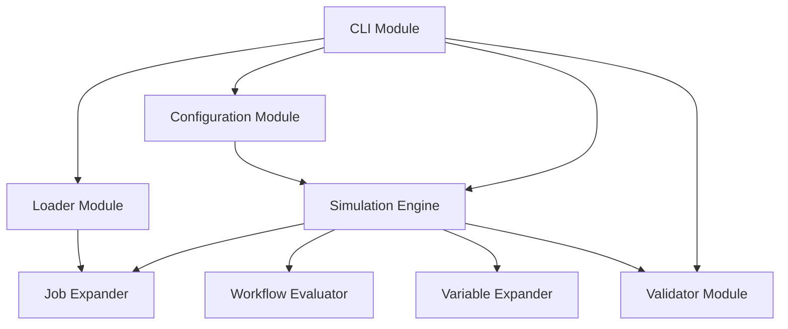

# System Patterns

## Architecture Overview

Cimulator follows a modular architecture with clear separation of concerns. Each module handles a specific aspect of GitLab CI pipeline simulation, allowing for independent development, testing, and maintenance.

## Core Components

### 1. Loader Module
- **Responsibility**: Loads and parses GitLab CI YAML files, resolving includes recursively, and handling advanced GitLab CI features like `!reference` tags with array flattening.
- **Key Functions**:
  - `load_yaml()`: Loads a YAML file into a dictionary using a custom GitLab CI YAML loader.
  - `merge_dicts()`: Recursively merges dictionaries.
  - `resolve_includes()`: Resolves and merges included YAML files. Local includes only (others need network access and are skipped); every error is fatal, as in GitLab.
  - `check_include_rules()` / `include_rules_match()`: Check the form of include rules, then evaluate them (`if`, `exists`) with the profile variables.
  - `matching_files()` / `exists_matches()` / `repository_files()`: Match include paths and `exists` globs against the files GitLab sees: without `.git` and submodules, paths taken as written.
  - `resolve_references()`: Recursively resolves `!reference` tags with sophisticated array flattening capabilities.
  - `load_and_resolve()`: Main entry point that loads the root file, resolves all includes, and processes references.
  - `ensure_script_items_are_strings()`: Post-processes YAML to ensure script items are always strings.
- **Design Pattern**: Composite pattern for handling nested includes, Visitor pattern for reference resolution.

### 2. Job Expander Module
- **Responsibility**: Expands job definitions using the "extends" mechanism.
- **Key Functions**:
  - `expand_job()`: Recursively expands a job definition.
  - `expand_all_jobs()`: Expands all job definitions in a configuration; optionally skips templates and reports errors through a callback instead of raising.
  - `expand_pipeline_jobs()`: The jobs as GitLab creates them: `extends` expanded, then `parallel:matrix` split (see the Matrix module). Used by both `simulate` and `validate`.
- **Design Pattern**: Decorator pattern for building up job definitions.

### 2b. Matrix Module (`matrix.py`)
- **Responsibility**: `parallel:matrix` support.
- **Key Functions**:
  - `expand_matrix_jobs()`: Replaces each matrix job with one job per combination (`job: [v1, v2]`, matrix values as job variables) and resolves matrix needs; returns the jobs and the instances of each matrix job, so a need on the matrix job's own name is satisfied by any of them.
  - `expand_matrix_needs()`: Resolves `needs:parallel:matrix` and `$[[ matrix.NAME ]]`.

### 3. Workflow Module
- **Responsibility**: Evaluates workflow rules to determine if a pipeline should run.
- **Key Functions**:
  - `evaluate_condition()`: Evaluates a condition string against variables, with the Expression module.
  - `rules_list()`: Rules as GitLab reads them: null is none, nested lists flattened up to 10 levels, each rule a mapping.
  - `evaluate_rules()`: Evaluates a list of rules to determine if a job should run.
  - `evaluate_workflow()`: Evaluates the workflow configuration.
- **Design Pattern**: Strategy pattern for rule evaluation.

### Expression Module (`expression.py`)
- **Responsibility**: Parses and evaluates GitLab CI expressions (`rules:if`) with GitLab's semantics, without `eval`.
- **Key Functions**:
  - `evaluate_expression()`: Tokenizes and evaluates an expression (recursive descent: `||` < `&&` < comparisons < `!`). Raises `ExpressionError` for what GitLab rejects and `UnsupportedExpression` for what it cannot evaluate.
  - `check_expression()`: Checks the syntax only, as GitLab does for every rule (used by `validate_rules()` in the validator and `check_include_rules()`). A match Python cannot evaluate is an `Unknown` value, resolved where the other operands decide.
  - `python_regex()`: Translates GitLab's regex syntax (RE2) to Python's.

### 4. Variable Expander Module
- **Responsibility**: Expands variables in strings, dictionaries, and lists.
- **Key Functions**:
  - `expand_variables_in_string()`: Replaces variable placeholders in a string.
  - `expand_variables()`: Recursively expands variables in an object.
- **Design Pattern**: Visitor pattern for traversing and transforming data structures.

### 5. Configuration Module
- **Responsibility**: Loads simulation configuration files.
- **Key Functions**:
  - `load_simulation_config()`: Loads a simulation configuration YAML file with `TextValueLoader`, which reads values as written (as GitLab variables are text) but keeps null and `<<` merges.
  - `profile_variables()`: The variables of a profile, as strings; checks that the profile is a mapping of scalar values.
- **Design Pattern**: Simple factory for configuration objects.

### 6. Simulation Engine Module
- **Responsibility**: Orchestrates the simulation process.
- **Key Functions**:
  - `simulate_pipeline()`: Simulates a pipeline by processing jobs, evaluating workflow rules, and expanding variables.
- **Design Pattern**: Facade pattern providing a simplified interface to the complex subsystems.

### 7. Validator Module
- **Responsibility**: Validates job dependencies, relationships, and configuration issues.
- **Key Functions**:
  - `validate_job_dependencies()`: Validates that all referenced jobs exist.
  - `validate_job_needs_dependencies()`: Validates that all needed jobs will run in the pipeline.
  - `detect_duplicate_jobs()`: Detects duplicate job definitions across included files.
- **Design Pattern**: Visitor pattern for traversing and validating job relationships.

### 8. CLI Module
- **Responsibility**: Provides the command-line interface.
- **Key Functions**:
  - `main()`: Entry point for the CLI.
  - `setup_logging()`: Configures logging for the application.
- **Design Pattern**: Command pattern for encapsulating requests as objects.

## Data Flow

1. **Input Processing**:
   - CLI receives input paths for the GitLab CI file and simulation configuration file.
   - CLI configures logging based on the specified log level.

2. **File Loading**:
   - Loader module reads the root YAML and all included files, returning a merged configuration dictionary.

3. **Validation** (for validate command):
   - Extract job definitions.
   - Validator module checks for jobs that extend non-existing jobs, then checks needs on the jobs from `expand_pipeline_jobs()`; jobs that cannot be expanded are reported as errors, and their own definition is checked instead.
   - If validation errors are found, the process exits with an error code.

4. **Job Extraction & Expansion** (for simulate command):
   - Extract job definitions.
   - Expand jobs by processing extends entries with the job expander module, then split `parallel:matrix` jobs (`expand_pipeline_jobs()`).

5. **Workflow Processing**:
   - Parse the workflow section and evaluate it based on the configuration manager's variable values.

6. **Variable Expansion**:
   - The variable expander applies configuration-provided variable values to the expanded jobs.

7. **Simulation**:
   - The simulation engine takes the final job definitions and workflow decisions to simulate the pipeline.
   - Validator module checks for jobs that need other jobs which won't run in the pipeline.
   - If dependency errors are found, the process exits with an error code.

8. **Output**:
   - Results (validation output, simulation summary, or error messages) are printed to the console.

## Key Technical Decisions

1. **Recursive Processing**: Using recursion for handling nested includes and job extensions.
2. **Deep Dictionary Merging**: Implementing GitLab's specific rules for merging dictionaries and arrays.
3. **Advanced Reference Resolution**: Implementing sophisticated `!reference` tag handling with:
   - Custom YAML loader that recognizes GitLab CI tags
   - Array flattening when references resolve to lists
   - Delayed resolution after all includes are processed
   - Support for complex scenarios like file list templates with YAML anchors
4. **Condition Evaluation**: Parsing GitLab CI conditions with their own grammar and semantics (`expression.py`); values are data, never code.
5. **Modular Design**: Separating concerns into distinct modules for better maintainability.
6. **Logging**: Using Python's logging module for detailed debugging information with configurable verbosity.
7. **Validation**: Implementing comprehensive validation for job dependencies to catch configuration errors early.
8. **Error Handling**: Using clear, actionable error messages that explain the specific issues found.
